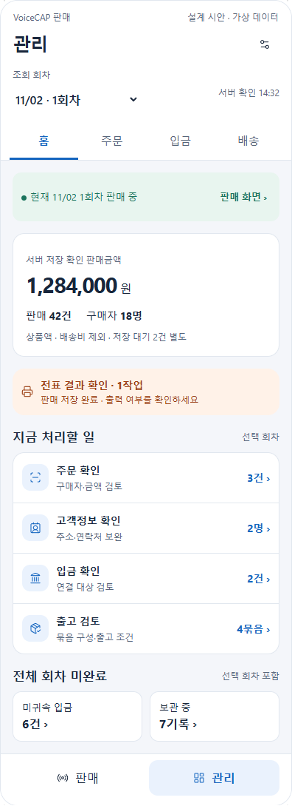
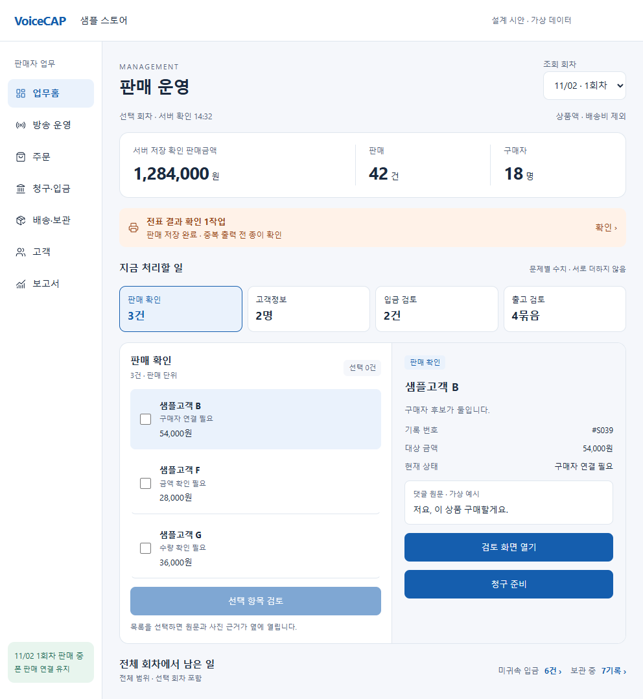

# VoiceCAP 판매 운영 재설계 제안

2026-11-02 · 검토 기준 `a14f4dca4a17a7e1396adcd4ea2c038253f4b1ff` · 제안 단계

## 제안의 핵심

관리의 첫 화면을 **판매자가 지금 끝내야 할 일을 안내하는 업무홈**으로 새로 설계한다. 안드로이드는 방송 중 짧은 확인과 한 건 처리에, 웹은 방송 후 검토와 여러 건 처리에 집중한다. 두 환경의 판매·입금·배송 계산은 같은 계약을 사용한다.

현재 판매내역 상단 카드의 배치나 색을 손보는 작업이 아니다. 정보구조, 집계 기준, 상세 화면, 업무 이동, 서버 조회 모델을 함께 다시 정한다. 이 제안에서는 제품 소스·DB·APK를 변경하지 않았다.

## 1. 프로젝트에서 실제로 판매되는 방식

세 가지 입력 경로가 있다. 웹 음성 판매, 댓글을 선택하는 터치 판매, 수동 입력이다. 터치 판매도 PC 연동과 폰 단독 방식이 있으며 프린터·촬영 경로가 다르다. 특정 판매 방식의 장치 상태를 모든 판매의 필수 조건으로 삼으면 안 된다.

공통 흐름은 다음과 같다.

1. **방송 회차와 판매 기록:** 구매자, 상품/번호, 수량, 금액, 댓글·음성·사진 근거를 판매에 연결한다. 서버 저장 대기와 확인 보류를 구별한다.
2. **주문 확인:** 고객 문자와 판매 기록을 대조해 구매자·연락처·주소·상품·금액을 확인한다. 구매자 한 명이 여러 판매 건을 갖는다.
3. **청구:** 선택한 판매들을 정산서로 묶고 상품액과 배송비를 구분해 안내한다.
4. **입금 확인:** 수신한 입금과 청구 대상을 연결한다. 이름이 비슷하다는 추천과 판매자가 확인한 귀속은 다르다.
5. **보관 또는 배송:** 일부 품목을 키핑하거나 출고 대상을 정해 포장·송장·발송 안내로 이어진다. 판매 1건, 구매자 1명, 정산서 1장, 배송 묶음 1개는 서로 다른 단위다.

확인과 입금, 보관은 병렬로 진행될 수 있다. 이를 `신규→결제→배송` 하나의 상태값으로 압축하지 않는다. 재설계에서는 늦은 입금을 입금 시각이 아니라 실제로 연결한 청구/판매에 귀속시킨다. 현재 일부 화면에는 회차 시작 이후 입금을 포함하는 시간 필터가 남아 있다.

코드 근거와 과거 문서와의 차이는 [EVIDENCE.md](EVIDENCE.md)에 정리한다.

## 2. 웹도 함께 설계해야 하는 이유

현재 안드로이드 판매 앱은 하나의 WebView와 로그인 상태로 판매·관리를 오간다. 관리에는 웹 판매내역 등의 화면이 들어간다. 앱만 별도 계산으로 새로 만들면 양쪽 숫자가 갈라진다.

정적 분석에서 다음 차이를 확인했다.

| 현재 상태 | 재설계 원칙 |
|---|---|
| 관리 진입은 `/sales`, 관리 내부 웹 하단 메뉴 5개와 네이티브 판매/관리 하단 탭이 중첩 | 관리 전용 시작점과 하나의 하단 전역 내비게이션 |
| 판매내역과 문자비교의 청구 가능 판매 필터가 다름 | 동일한 조회 모델에서 합계와 대상 목록을 제공 |
| 판매확정액·입금액·청구액이 다른 개념인데 화면별 판정이 분산 | 돈의 이름과 계산 근거를 구별 |
| 닉네임/입금자명으로 추정한 연결이 입금 표시에도 사용됨 | 후보 추천, 확인된 배분, 미귀속 입금을 별도 표시 |
| 배송 후보 생성에 주소·전화는 필요하지만 완납 필수 검사는 없음 | ‘배송 후보’와 신규 정책의 ‘출고 조건 충족’을 구별 |
| 보관은 유사 닉네임을 이용하고 배송은 회차·닉네임 단위가 많음 | 확정은 안정적인 구매자 ID, 판매 ID, 배송 묶음으로 수행 |

기존 화면의 오류 가능성을 이 제안에서 수정했다고 보지 않는다. 구현의 첫 단계에서 공통 기준을 만든 다음 해당 화면들을 순차 교체한다.

## 3. 새로운 정보구조

### 안드로이드

네이티브 전역 하단 탭은 **판매 / 관리**를 유지한다. 관리 안의 두 번째 하단 메뉴는 제거하고 상단에 **홈 / 주문 / 입금 / 배송**을 둔다. 설정·장치·보고서·구독은 상단 더보기에서 연다.

- **홈:** 판매 상태, 최소 실적, 확인할 일, 직전 회차에서 남은 일.
- **주문:** 판매 목록, 구매자별 묶음, 주문 확인, 청구서 작성/발송.
- **입금:** 미귀속 입금, 연결 추천, 확인할 입금, 확인 완료 내역.
- **배송:** 고객정보 부족, 보관, 출고 검토, 포장, 발송.

상세 화면에서는 상단에 ‘뒤로 + 대상 이름’을 표시한다. 홈의 큐에서 상세를 연 뒤 돌아오면 원래 회차·필터·스크롤을 복구한다. 네이티브 하단 판매/관리는 계속 접근할 수 있다.

### 웹

웹의 판매자 영역은 **업무홈 / 방송 운영 / 주문 / 청구·입금 / 배송·보관 / 고객 / 보고서**로 재편한다. 장치·청취 단어·규칙은 설정 아래로 묶는다. 관리자용 `/admin`은 판매자 업무홈과 별개다.

웹 업무 화면은 왼쪽 대상 목록, 오른쪽 근거·상세 패널을 기본으로 삼는다. 폰에서는 동일한 대상을 한 화면씩 연다. 웹은 여러 행 선택과 일괄 처리의 결과 확인을 지원한다. 화면 배치까지 공통 컴포넌트 하나로 강제하지 않는다.

## 4. 안드로이드 관리 홈의 화면 설계

권장안은 **업무 우선형**이다. 대안인 회차 마감형은 방송 종료 후 특정 회차를 정리할 때 유용하지만, 여러 회차의 입금·보관을 놓치기 쉬워 기본 홈으로 추천하지 않는다.

위에서 아래로 다음과 같이 구성한다.

| 영역 | 내용 및 동작 |
|---|---|
| 앱 바 | ‘관리’와 설정. 현재 작업공간을 확인할 수 있다. |
| 범위 선택 | 기본은 현재 진행 회차, 없으면 마지막 회차. 날짜만 쓰지 않고 `11/02 · 1회차`로 명시. |
| 관리 내 메뉴 | 홈·주문·입금·배송. 항상 같은 순서. |
| 판매 상태 | 방송 중이면 ‘판매 중 · 판매 화면으로’. 댓글·저장·전표·촬영 상태는 실제 사용 경로만 표시. |
| 핵심 실적 | 서버 저장 확인 판매금액, 판매 건수, 구매자 수. 배송비 제외 문구. 탭하면 산출 대상 목록. |
| 가장 먼저 확인 | 저장 실패/충돌, 출력 결과 미확인 등 현재 판매에 영향을 주는 장애 1~2개. 이상이 없으면 이 영역을 감춤. |
| 처리할 일 | 주문 확인 → 청구/고객정보 → 입금 확인 → 출고 검토. 원인·대상 수·단위·다음 행동을 표시. |
| 전체 회차 미완료 | 선택 회차를 포함한 전체 회차의 요약. 선택 회차의 카드와 더하지 않는다. 미귀속 입금·보관품 등의 범위를 명시. |
| 전역 하단 | 네이티브 판매 / 관리 2개. 관리에 오더라도 판매 실행을 유지. |

### 화면에 쓰는 문구

- `판매 42건 · 구매자 18명`처럼 단위를 쓴다. 수량이 필요하면 `상품 47개`로 별도 표기한다.
- `입금 확인 2건`은 수신된 입금 2건이다. `미입금 청구서 3장`과 섞지 않는다.
- `출고 검토 4묶음`은 만들어진 배송 묶음 4개다. 아직 묶음이 없다면 `배송 후보 구매자 4명`이라고 쓴다.
- `서버 저장 대기 2건`은 확정 실적 아래 따로 표시한다. 출력됐다는 이유로 저장 완료로 취급하지 않는다.
- `보관 중`은 정상적인 고객 요청일 수 있다. 오류·미처리로 몰아붙이지 않고 보관 기간과 출고 요청 여부를 보여 준다.
- `정산`만 쓰지 않는다. 고객에게 보내는 것은 ‘청구서(기존 정산서)’, 통계는 ‘판매 집계’, 은행 입금은 ‘입금 확인’으로 구별한다.

### 판매 전·중·후

- **판매 전:** 판매 준비로 이동하는 버튼과 이전 회차 미완료를 먼저 보여 준다. 댓글/프린터/촬영 조건은 선택한 판매 방식에 맞춘다.
- **판매 중:** 판매 복귀를 고정된 위치에 둔다. 입금 일괄 승인이나 회차 마감은 홈의 주 행동으로 두지 않는다.
- **판매 종료 후:** 같은 배치에서 회차 검토와 청구 준비를 위로 올린다. 주문 확인 → 청구 → 배송 관련 남은 일을 보여 주되 하나의 진행률로 합치지 않는다.
- **이전 회차 조회:** 현재 진행 중인 방송 띠와 ‘조회 중인 회차’가 다르다는 점을 표시한다. 과거 회차의 버튼으로 현재 방송을 종료할 수 없다.

## 5. 후속 상세 화면

### 주문 작업 공간

구매자별 카드에 상품액, 판매 건수, 주문 확인, 청구, 입금, 보관/배송을 독립 상태로 표시한다. 닉네임만으로 다른 사람의 주문을 합치지 않는다. 구매자 신원이 불명확한 행은 ‘구매자 연결 필요’로 남긴다.

상세는 `상품 / 고객정보 / 청구·입금 / 배송 / 근거·이력`으로 나눈다. 사진·댓글·음성을 다시 찾기 위해 메뉴를 왕복하지 않게 한다. 보류는 빠진 필드만 보완한다. 이미 청구·입금·발송한 거래를 변경하면 영향 범위와 새 확인 작업을 안내한다.

### 청구와 입금

청구 작성은 `구매자와 판매 선택 → 배송비·보관·주소 확인 → 발송 미리보기 → 결과` 흐름이다. 문자 큐 등록을 고객 수신 완료로 표시하지 않는다. 발송 실패/미확인은 재검토 대상으로 남는다.

입금 화면은 왼쪽(폰에서는 첫 목록)에 수신 입금을, 상세에 청구 후보를 보여 준다. 추천 이유, 입금액, 청구잔액, 차액을 함께 표시한다. 추천을 보여 주는 순간 완납으로 바꾸지 않는다.

**새 입금 배분 원장이 준비되기 전에는** 현재 연결과 판매자가 확인한 사실만 보여 준다. 기존 UI에서 부분입금처럼 보이는 합계가 있어도 이를 새 배분 원장이 구현된 것으로 취급하지 않는다. 원장 도입 후 한 입금의 분할 배분, 여러 입금의 합산, 초과입금, 배분 취소를 제공한다.

### 배송과 보관

출고 전에 포함 판매와 수량, 구매자, 수령인·주소, 보관품, 배송비를 검토한다. 판매 전표와 택배 송장은 다른 출력물임을 구별한다. 한 구매자의 여러 회차 합배송과 한 판매의 수량 분할은 향후 배송 묶음/품목 모델로 지원한다.

신규 출고 정책의 추천 기본값은 **고객정보 확인 + 판매 서버확정 + 청구/입금 조건 충족 + 보관해제 + 미출고 수량**이다. 이것은 현재 동작이 아니라 제안이다. 미입금 출고를 허용하려면 명시적인 권한과 사유를 기록한다. 기존 고객의 출고 흐름에 조용히 적용하지 않는다.

취소된 배송의 판매를 무조건 영구 제외하지 않는다. 재출고 가능 수량과 이전 송장 취소 상태를 검토한다. 보관 해제는 실제 출고 확정과 연결하고 이미 청구한 상품액·배송비를 다시 청구하지 않는다.

### 웹의 일괄 처리

필터의 전체 결과 수와 선택 수를 구분한다. 첫 페이지 선택을 전체 선택으로 보이게 하지 않는다. 일괄 작업 전 대상·금액·부족한 조건을 미리 보여 주고, 결과를 성공/실패/충돌로 나눈다. 재시도는 실패한 작업만 같은 작업 ID로 수행한다. 다른 장치에서 변경한 항목을 덮어쓰지 않는다.

## 6. 양쪽에서 지켜야 할 상태와 지표 계약

### 서로 독립적인 상태 축

| 축 | 예시 |
|---|---|
| 저장 | 로컬 대기 / 서버 확인 / 실패 / 충돌 |
| 판매 판정 | 유효 / 보류 / 취소 / 비판매 |
| 주문 확인 | 고객정보 부족 / 대조 필요 / 확인됨 |
| 청구 | 미작성 / 초안 / 발송 대기 / 발송 / 취소 / 변경 검토 |
| 입금 | 미귀속 / 추천 / 배분 확인 / 잔액 있음 / 초과입금 |
| 이행 | 보관 / 출고 검토 / 포장 / 발송 / 취소 / 재출고 검토 |
| 운영 | 전표 대기·실패·결과 미확인, 사진 상태, 판매 연결 |

표의 모든 값이 현재 DB enum으로 있다는 뜻은 아니다. UI 라벨과 서버 상태의 매핑을 먼저 정하고, 새 업무에 필요한 값은 계약과 마이그레이션으로 추가한다.

### 지표 사전

| 표시 | 제안 산식·범위 |
|---|---|
| 판매금액 | 선택 회차의 서버 저장 확인 + `isBillableSale`을 만족하는 판매 amount 합. 배송비 제외. 보류·취소·비판매·미전송 제외. |
| 판매 건수 | 위 판매의 고유 saleId 수. 상품 수량 합과 다름. |
| 구매자 수 | 위 판매에서 확인된 buyerId 수. ID가 없는 동명/미확인 고객은 별도 수로 제공하고 몰래 병합하지 않음. |
| 미이행 반영 판매액 | 판매금액에서 판매자가 약속미이행으로 확정한 해당 구매자·회차의 유효 판매액 제외. 입금액과 다름. 보고서/상세에 배치. |
| 활성 청구액 | 취소/대체되지 않은 청구 버전의 상품액 + 확정 배송비·조정액. 전회차 보관품을 중복 청구하지 않음. |
| 확인 배분액 | 해당 청구에 확정 배분한 입금액의 합. 입금 수신 총액, 매칭 추천액과 다름. |
| 미수액 | 청구별 `max(활성 청구액 - 확인 배분액, 0)`의 합. 다른 청구의 초과입금으로 임의 상계하지 않음. 배분 원장 이후 제공. |
| 미귀속 입금 | 수신액 중 아직 확정 배분되지 않은 잔액. 선택 회차 매출로 임의 집계하지 않음. |
| 출고 묶음 | 실제 fulfillmentGroupId 수. 상자 수를 관리하려면 별도 packageId 모델 필요. |

금액은 원 단위 정수로 계산하고 줄 수·수량·구매자 수를 따로 반환한다. 약속미이행은 판매자의 명시적 결정이며 오래 미입금이라는 이유만으로 자동 확정하지 않는다. 판매 취소·채권 포기·반품·환불과도 같은 사건이 아니다.

합계 카드와 누른 뒤 나오는 목록은 동일한 `filterToken`, `asOf`, metricVersion을 사용한다. 목록 첫 페이지나 클라이언트에 로드된 일부 판매만으로 전체 실적을 계산하지 않는다.

## 7. 필요한 데이터와 API 설계

다음은 **신규 계약 초안**이다. 현재 API가 구현된 것으로 보지 않는다.

```text
ManagementOverview
  scope: sessionIds | ALL_UNFINISHED, businessTimeZone
  asOf, metricVersion, snapshotVersion, completeness
  sales: amount, saleCount, quantity, knownBuyerCount, unresolvedBuyerCount
  queueGroups: reasonCode, targetType, count, unit, filterToken, allowedAction
  currentRun: sessionId, producerMode, capabilities, heartbeatAt, runState
  nextCursor, warnings

ManagementWorkItem
  id, targetType, targetId, reasonCode, reasonRevision
  sessionIds, buyerRef, amount?, occurredAt, age
  blockingReasons[], allowedActions[], evidenceRefs[], expectedRevision

PaymentAllocation (후속 추가)
  id, receiptId, invoiceId, amount, operationId, revision, reversedBy?

FulfillmentGroup / FulfillmentLine (후속 추가)
  id, buyerId, recipientSnapshot, feeSnapshot, policyVersion, revision
  lines: saleId, quantity, sourceKeepingId?
  paymentException?, packingState, shipmentRefs[]
```

초기에는 기존 `sales-api`에 `management-overview` / `management-work-items`에 해당하는 조회를 추가한다. workspace는 인증에서 결정하며 클라이언트의 workspaceId만으로 권한을 정하지 않는다. 기존 원장을 참조하는 조회 모델을 사용한다.

변경은 판매·청구·배송의 업무 명령을 사용한다. 신규 명령은 operationId, 예상 revision, 권한, 관련 행의 동일 workspace, 부분 실패, 이력을 검증한다. 홈 카드를 누르면 대상 목록이 열리고 청구 발행·입금 확정·발송·일괄 재출력은 별도 검토 후 실행한다.

조회 계약은 영역별 최신성과 완전성을 반환한다. 기존 commerce 테이블 조회는 페이지 처리가 없으므로 프런트에 내려온 배열만으로 전체 회차 실적을 확정하지 않는다. 마지막 읽기에 실패하면 `불러오지 못함 · 마지막 확인 HH:mm`으로 표시한다. 다른 장치의 변경으로 건수가 달라지면 새로고침을 안내하고, 읽는 중인 상세를 갑자기 재정렬하지 않는다.

## 8. 구현 경계와 이전

### 재사용할 기반

- 네이티브 판매 서비스, BLE, 카메라, 인증, 단일 WebView와 판매 화면을 숨겨 유지하는 구조.
- 기존 판매 ID·revision·operation·출력 작업, 사진·댓글·수정 이력.
- 청구·배송·문자 발송 등의 상세 처리. 이전 중에도 같은 원장에 기록한다.

### 새로 만들거나 재편할 것

- 공통 상태 판정·집계 서비스와 서버 조회 모델.
- `ManagementHome`, `OrderWorkspace`, `PaymentWorkspace`, `FulfillmentWorkspace`.
- 웹 목록/상세와 안드로이드 카드/상세의 표시 계층.
- 필요한 입금 배분·배송 품목·구매자 식별 계약과 데이터 이전.

제안 경로는 `/manage`, `/orders`, `/payments`, `/fulfillment`다. 현행 `/sales`, `/invoices`, `/customer-messages`, `/shipments`, `/settlement`는 이전 중 유지한다. 새 화면이 같은 업무를 지원한 단계에서 필터를 보존하며 연결한다. 안드로이드 관리 최초 진입은 `/manage`, 이후에는 전 위치를 복원하고 선택된 관리 탭을 다시 누르면 홈으로 돌아온다. 현재 네이티브는 재탭에도 이벤트를 보내므로 웹의 경로 상태로 재탭을 판별할 수 있는지 먼저 확인하고, 필요한 경우에만 브리지를 보강한다.

네이티브 하단은 웹 바깥에 있으므로 웹 레이아웃만 바꾸고 완료로 보지 않는다. 구버전 앱 지원 capability, safe-area, 키보드, 안드로이드 뒤로 동작을 함께 검증한다. Compose 전면 이전은 이번 설계의 전제가 아니다.

## 9. 개발 순서와 완료 조건

| 단계 | 산출물 | 다음 단계로 가는 조건 |
|---|---|---|
| 기준 고정 | 상태표, 지표 사전, 기존 데이터 매핑, 화면 이동 | 업무 용어와 현재 데이터의 차이를 검토할 수 있음 |
| 조회 기반 | overview/work-items, 공통 산식, 권한·페이지 처리 | 같은 데이터에서 폰·웹·대상 목록의 수치가 일치 |
| 새 홈 | 안드로이드 관리 홈, 웹 업무홈, 장애·오래된 데이터 표시 | 기존 상세를 오가면서 댓글 수신·저장·출력이 유지 |
| 주문·청구 | 구매자 상세, 근거 패널, 청구 전 검토 | 기존 정정·취소·문자·이력을 보존하고 중복 청구 차단 |
| 입금·배송 원장 | 배분, 배송 품목, 보관·출고, 예외 승인 | 다중 장치·재송신·부분입금·합배송/분할에서 중복 방지 |
| 후속 확장 | 반품·환불, 고객 통합, 분석 | 원거래·조정을 추적하고 금액·수량 대사가 성립 |

개발 일수는 미산정이다. 데이터 불일치와 원장 부족을 먼저 평가하고 작업량을 산정한다.

### 검수 시나리오

1. 서버 저장 확인 42건과 로컬 미전송 2건이 있으면 실적에는 42건을 표시하고 대기 2건을 분리한다.
2. 보류·취소·비판매·약속미이행·동명 별도 buyerId가 섞여도 같은 범위의 폰·웹·CSV 정의와 값이 일치한다.
3. 어제 청구에 대한 오늘 입금은 해당 청구에 배분되며 오늘 판매 실적으로 더해지지 않는다.
4. 입금 1건→청구 2장, 입금 2건→청구 1장, 초과·미귀속·배분 취소에서 금액을 중복 계산하지 않는다. 원장 도입 전에는 제공 완료로 표시하지 않는다.
5. 보관품과 새 주문을 합배송해도 상품액·배송비를 중복 청구하지 않는다. 부분 출고와 재출고는 남은 수량을 지킨다.
6. 관리 상세를 읽는 동안 댓글 수신·카메라·저장·출력이 이어지고 뒤로 이동해도 실행 상태가 유지된다.
7. 출력 결과 UNKNOWN은 실패로 단정하지 않는다. 확인과 재출력으로 판매를 중복 생성하지 않는다.
8. 오프라인·일부 조회 실패·권한 만료·다중 장치 충돌을 0건·완료·최신으로 표시하지 않는다.
9. 작은 화면·글자 200%·키보드·시스템 바·한 손 사용에서 주요 동작이 가려지지 않는다. 웹은 키보드와 목록/상세의 포커스 복원을 확인한다.
10. 새 화면 기능을 꺼도 기존 판매 ID·미전송 operation·출력 이력·입금 배분·보관 기록은 보존된다.

## 10. UI 기준과 검토용 예시

대화의 시안은 가상의 판매·고객·금액을 사용한다. 운영 서버와 연결하지 않으며 버튼은 화면 이동·필터 검토용이다.

| 안드로이드 관리 홈 · 권장 | 웹 업무홈 |
|---|---|
|  |  |

추가 화면: [전표 결과 확인](previews/android-print-review.png), [회차 마감형 대안](previews/android-session-close.png).

안드로이드는 본문 16sp, 보조 정보 12sp 이상, 터치 영역 48dp 이상, 기준 여백 16dp를 목표로 설계한다. 글자를 확대하면 줄바꿈과 한 열 배치를 우선한다. 상태에 색과 문구를 함께 쓴다. 좁은 화면은 한 화면씩, 넓은 화면은 목록과 상세를 나란히 배치한다. WebView의 CSS로 적용할 수 있으며 라이브러리 이전을 요구하지 않는다.

참고: 안드로이드 공식 [화면 크기별 내비게이션](https://developer.android.com/develop/adaptive-apps/guides/build-adaptive-navigation), [48dp 터치 영역](https://developer.android.com/guide/topics/ui/accessibility/views/apps-views), [화면 구성](https://developer.android.com/design/ui/mobile/guides/layout-and-content/content-structure). 확인일 2026-11-02.

### 이번 제안에서 확인한 범위

- 최신 main 기준 판매·청구·입금·보관·배송과 안드로이드/웹 화면의 코드 근거를 대조했다.
- 예시 화면에서 회차 변경, 판매/관리 복귀, 주문→청구 준비, 전표 근거, 입금 목록, 웹 선택/일괄 검토의 화면 이동을 브라우저로 확인했다.
- 폰 320/396/736px, 웹 320/736/1024px에서 내용의 가로 넘침과 JavaScript 실행 오류가 없음을 확인하고 밝은/어두운 테마를 렌더링했다.
- 제품 코드를 변경하지 않았으므로 앱 빌드·DB 변경·운영 배포·실기기 판매 검증은 수행 범위가 아니다. 위 확인은 구현 완료 검수가 아닌 설계 시안의 표시·이동 확인이다.

## 권장안

**업무 우선형 관리 홈 + 웹과 공통 원장·집계 + 각 환경에 맞는 상세 화면**을 채택한다. 첫 구현 범위는 공통 조회 계약과 폰·웹 업무홈이다. 입금 배분·합배송·반품·환불은 필요한 원장을 갖춘 단계에서 제공한다. 판매 중 동작과 기존 기록을 보존하며 단계적으로 이전한다.
