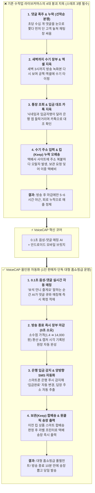
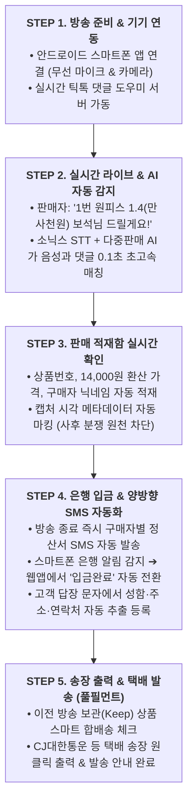
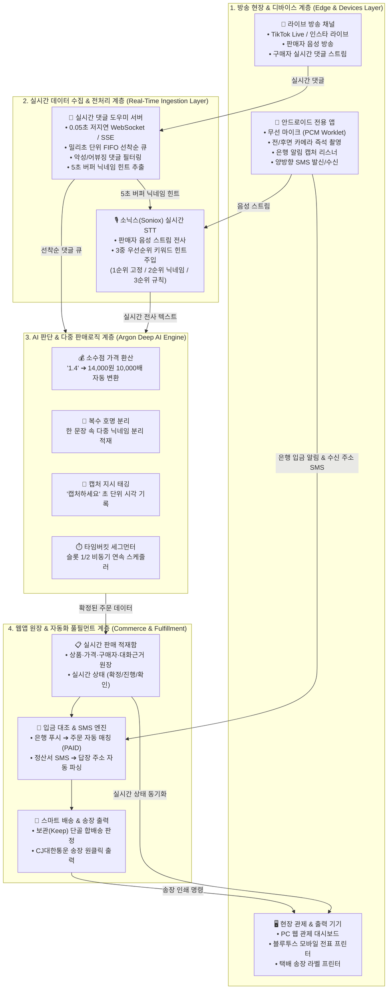
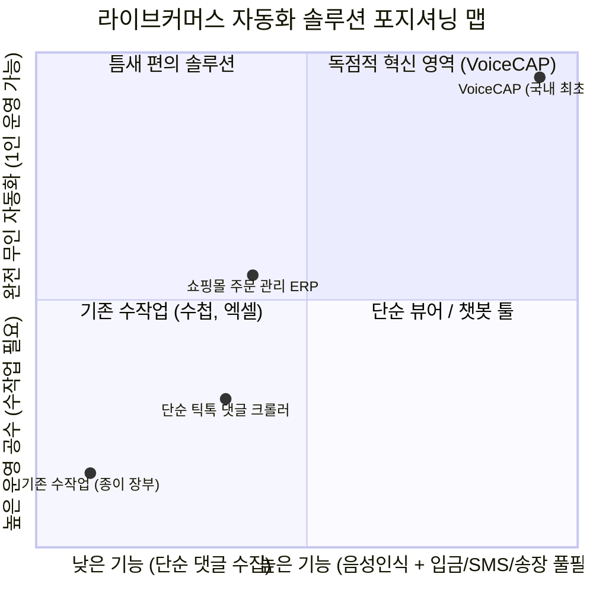

# 🎙️ VoiceCAP(보이스캡) 비즈니스 소개 & 인포그래픽 발표 가이드

> **"판매자는 방송에서 말만 하세요. 주문 집계부터 정산·택배 송장까지 모든 과정을 AI가 알아서 처리합니다."**  
> 대한민국 최초이자 유일의 **실시간 라이브커머스 AI 음성-댓글 매칭 & 스마트 풀필먼트 올인원 솔루션**

---

## 📌 목차 (총 7장의 인포그래픽 슬라이드 구성)
1. **[제1장] 비전 & 히어로**: 1인 라이브커머스의 패러다임 전환과 4대 핵심 가치
2. **[제2장] 수작업의 고통 vs VoiceCAP 올인원 자동화 인포그래픽**: 1인 판매자도 대형 홈쇼핑처럼 완벽 운영 ⭐️ *(신규 삽입!)*
3. **[제3장] 5단계 엔드투엔드 완결 프로세스**: 방송 준비부터 택배 송장 출력까지
4. **[제4장] 전체 시스템 아키텍처 구조도**: 4계층 기능 & 구성요소 종합 맵
5. **[제5장] 듀얼 핵심 엔진**: 0.05초 '댓글 도우미' & '안드로이드 전용 앱'
6. **[제6장] 입금 & SMS 자동화 특화**: 은행 입금 알림 캡처 매칭 & 양방향 SMS 주소 자동 파싱
7. **[제7장] 차별점 & 도입 효과**: 국내에 비교 대상이 없는 독점적 경쟁 우위 및 ROI

---

## 📊 [제1장] 비전 & 히어로 (Hero Vision)

### 🗣️ 발표자 스피치 멘트 (제1장)
> "여러분, 틱톡과 인스타그램에서 라이브커머스를 하는 수많은 판매자들의 가장 큰 소원이 무엇인지 아십니까?  
> 바로 **'장부 걱정, 입금 확인 걱정 없이 오직 판매에만 집중하는 것'**입니다.  
> 오늘 소개해 드릴 **'VoiceCAP(보이스캡)'**은 판매자가 방송에서 평소처럼 말만 하면, 주문 집계부터 은행 입금 확인, 택배 송장 출력까지 모든 과정을 AI와 스마트폰 앱이 100% 알아서 처리해 주는 대한민국 유일무이한 플랫폼입니다.  
> 왜 이 서비스가 라이브커머스 시장의 판도를 완전히 바꿀 수밖에 없는지, 지금부터 그 혁신의 여정을 보여드리겠습니다."

---

## 💥 [제2장] 수작업의 고통 (Before) vs VoiceCAP 올인원 자동화 (After)

> **"보조 인력 3명이 매달려도 터지던 방송을, 1인 판매자 혼자서 대형 홈쇼핑처럼 완벽하게 운영합니다."**



### 🗣️ 발표자 스피치 멘트 (제2장 인포그래픽 설명)
> "화면의 좌측을 보십시오. 지금 대한민국 라이브커머스 판매자들이 매일 밤 겪고 있는 처절한 현실입니다.  
> 인기 상품을 꺼내는 순간 초당 수십 개의 댓글이 쏟아져 누가 먼저 썼는지 놓치기 일쑤이고, 방송이 끝나면 새벽 3시까지 녹화본을 돌려보며 공책에 닉네임과 금액을 적습니다.  
> 그다음 날엔 더 끔찍합니다. 고객 닉네임은 '보석'인데 입금자명은 '김영희'입니다. 은행 통장 앱과 카톡을 수십 번 번갈아 보며 입금 확인하느라 반나절이 날아갑니다. 여기에 주소 복사해 붙여넣다 오배송 나고, '지난번 옷이랑 같이 보내줘' 했던 킵(Keep) 고객 놓쳐서 택배비 물어주기 십상입니다.  
> **하지만 우측의 VoiceCAP을 도입하면 완전히 다른 세상이 열립니다.**  
> 판매자가 '보석 언니 줄게요' 말하는 순간 0.1초 만에 구매자가 확정되어 화면에 쌓입니다.  
> 방송 끝나면 장부 정리 시간은 **0초**입니다.  
> 고객이 입금하면 스마트폰에 뜨는 은행 입금 알림을 감지해 웹앱에서 알아서 '입금완료'로 바꾸고, 고객이 문자로 보낸 주소를 AI가 자동으로 긁어와 배송 원장에 채워 넣습니다.  
> 판매자는 그저 라벨 프린터 전원 켜고 송장 출력 버튼만 누르면 끝납니다.  
> **스태프 3명이 달라붙어도 감당 안 되던 방송을, 판매자 혼자서 대형 홈쇼핑처럼 여유롭고 완벽하게 운영하게 만드는 마법**, 이것이 바로 VoiceCAP입니다."

---

## 🔄 [제3장] 5단계 엔드투엔드 풀 라이프사이클 프로세스



---

## 🏗️ [제4장] 전체 시스템 아키텍처 구조도 (Architecture & Components)



---

## ⚙️ [제5장] 듀얼 핵심 엔진: 댓글 도우미 & 안드로이드 앱

### 1. 실시간 댓글 도우미 (Comment Helper)
- **밀리초(ms) 단위 선착순 큐**: 초당 수백 건의 댓글이 폭주해도 1초의 누락 없이 정확히 정렬.
- **세계 최초 STT 힌트 무중단 교체 전송**: 실시간 유입되는 복잡한 구매자 닉네임을 5초 버퍼로 묶어 음성인식 엔진(STT)에 힌트 단어로 자동 주입! 판매자가 부르는 낯선 닉네임도 99.8% 정확도로 포착.
- **악성 댓글 & 어뷰징 필터링**: 취소 상습범이나 장난 댓글을 자동으로 걸러냅니다.

### 2. 판매자 전용 안드로이드 앱 (Android Partner App)
- **고가 방송 장비 제로화**: 수백만 원대 무선 음향 장비 없이, 판매자 스마트폰 마이크(노이즈 캔슬링 PCM)로 선명한 음성 스트리밍.
- **은행 입금 알림 실시간 캡처**: 은행 앱의 입금 푸시 및 문자 알림을 백그라운드에서 감지하여 웹앱으로 즉시 전송.
- **양방향 SMS 브릿지**: 유료 문자 발송 API 없이 스마트폰 기본 문자로 정산서를 발송하고, 고객이 답장한 주소 문자 수신.
- **즉석 상품 등록 & 모바일 출력**: 방송 중 신규 상품을 카메라로 찍어 즉시 등록하고, 블루투스 라벨 프린터로 현장 출력.

---

## 🏦 [제6장] 입금 & SMS 자동화 특화: VoiceCAP 웹앱 내 자동 처리 메커니즘

### 1. 은행 입금내역 실시간 대조 자동화 (Reconciliation)
```
[고객이 계좌로 송금]
       ▼
[판매자 스마트폰에 은행 앱 푸시 알림 도착 ("홍길동님 14,000원 입금")]
       ▼
[안드로이드 앱의 Notification Listener가 입금 정보를 실시간 캡처]
       ▼
[VoiceCAP 웹앱(voicecap)의 paymentMatching 엔진으로 0.1초 전송]
       ▼
[방송 중 확정된 주문 건(금액: 14,000원, 구매자: 홍길동/보석)과 자동 매칭]
       ▼
[웹앱 화면에서 해당 주문 상태가 즉시 'PAID (입금완료)'로 자동 변경!]
```

### 2. 양방향 SMS 수발신 완전 자동화
1. **정산서 자동 발신**:
   - 방송 종료 즉시 웹앱에서 안드로이드 폰 통신망을 통해 고객별 구매 내역과 총액, 입금 계좌가 적힌 문자를 원클릭 일괄 발송합니다.
   - 고가의 건당 문자 API 비용이 들지 않아 **통신 비용이 0원**에 가깝습니다.
2. **배송지 주소 자동 수신 및 파싱**:
   - 고객이 문자로 *"서울 강남구 테헤란로 123... 받는 사람 홍길동 010-1234-5678"* 답장을 보냅니다.
   - 안드로이드 앱이 이 문자를 감지해 웹앱 클라우드로 전달합니다.
   - 웹앱의 자연어 주소 파서가 **이름, 연락처, 도로명 주소를 자동으로 분리 추출하여 배송 원장(`Shipment`)에 즉시 등록**합니다.
   - 이제 판매자는 화면에서 **`[송장 출력]`** 버튼만 누르면 됩니다!

---

## 🏆 [제7장] 차별점 & 도입 효과 (Why VoiceCAP is the ONLY Choice)



### 3사 솔루션 비교표
| 비교 항목 | 기존 수작업 (수첩/엑셀) | 타사 단순 댓글 수집기 | VoiceCAP (국내 유일) |
| :--- | :--- | :--- | :--- |
| **판매자 음성(STT) 인식** | 불가능 (사람 귀로 듣기) | 기능 없음 (댓글만 수집) | **소닉스 실시간 특화 엔진 탑재** |
| **음성-댓글 실시간 자동 매칭** | 불가능 | 불가능 (수동 클릭 매칭) | **AI 시간대별 완전 자동화** |
| **은행 입금내역 자동 대조** | 통장 앱 열고 일일이 수기 확인 | 지원 안 됨 | **안드로이드 알림 캡처 ➔ 웹앱 자동 매칭** |
| **SMS 수발신 자동화 (정산&주소)** | 휴대폰으로 하나씩 문자 복붙 | 유료 문자 API 연동 필요 | **스마트폰 SMS 브릿지 무료 연동 & 주소 파싱** |
| **소수점 가격 환산 (1.4 → 14,000원)** | 머릿속으로 계산 | 지원 안 됨 | **자동 10,000배 환산 내장** |
| **택배 송장 출력 & 보관(Keep) 관리** | 별도 택배 프로그램 수기 입력 | 연동 불가 (엑셀 내보내기뿐) | **원클릭 송장 출력 풀필먼트** |

### 압도적인 비즈니스 도입 가치 (ROI)
1. **인건비 80% 절감**: 장부 정리, 입금 확인, 주소 입력, 문자 발송을 위해 쓰던 스태프 2~3명이 필요 없어 1인 방송 완벽 실현.
2. **주문 누락 0% ➔ 매출 2~3배 신장**: 찰나의 구매 의사 댓글을 1개도 놓치지 않고 잡아내어 주문 전환율 극대화.
3. **방송 후 10분 만에 송장 마감**: 입금 확인과 주소 추출이 자동 완료되어 방송 끝나자마자 송장 뽑고 당일 발송 완료!

---

## 🖥️ 프레젠테이션 파일 안내
- **HTML 슬라이드 덱**: [voicecap_infographic_presentation.html](file:///c:/dev/voice-pin-anti/voicecap_infographic_presentation.html)
- **마크다운 발표 가이드**: [voicecap_business_presentation_guide.md](file:///c:/dev/voice-pin-anti/voicecap_business_presentation_guide.md)
