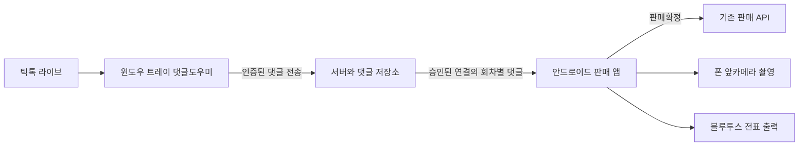

# VoiceCAP 윈도우 댓글도우미와 안드로이드 연결 개발 계획서

작성일: 2026년 11월 3일  
대상: 구현을 인계받는 AI 개발 에이전트  
저장소: `C:\dev\voice-pin-anti`  
기준: HEAD `08207cb`와 현재 작업 폴더의 수정 및 신규 파일을 함께 확인한다.

## 1 개발 목표

기존 윈도우 트레이의 VoiceCAP 댓글도우미가 틱톡 라이브 댓글을 수집하고, 판매자가 승인한 안드로이드 판매 앱에 전달하도록 확장한다. 판매자는 도우미에서 연결을 켜고 끄며 폰을 인증하고 연결을 해제할 수 있어야 한다.

댓글 수집은 PC 도우미가 담당하고, 판매 실행의 주체는 기존처럼 폰으로 유지한다. 폰의 판매확정, 앞카메라 촬영, 블루투스 전표 출력, 판매내역 관리 흐름을 보존한다. PC 홈페이지를 닫아도 트레이 도우미만 실행 중이면 댓글을 전달해야 한다.

현재 폰에서 댓글이 2~3분 표시된 뒤 멈춘다는 문제가 있다. 사용자는 원인 분석을 뒤로 미루고 기존 도우미 활용을 우선하도록 지시했다. 이번 작업은 수집 경로를 바꾸는 개발이다. 기존 장애의 근본 원인을 규명했거나 이 경로 변경만으로 모든 장애가 사라진 것으로 보고하지 않는다.

## 2 첫 출시 범위

| 항목 | 요구사항 |
| --- | --- |
| 실행 환경 | 기존 Windows Electron 댓글도우미와 Android 판매 앱 |
| 연결 수 | 판매자 작업공간당 PC 도우미 1대와 인증된 판매 폰 1대 |
| 사용자 제어 | 도우미에서 안드로이드 댓글 연결 켜기와 끄기, 폰 승인과 거절, 연결 해제 |
| 최초 인증 | PC의 판매자 계정 등록, 폰의 판매자 로그인, 일회용 연결 코드 또는 QR, PC의 최종 승인 |
| 통신 | 서버를 경유해 서로 다른 네트워크에서도 연결. PC는 유선 또는 와이파이, 폰은 와이파이 또는 LTE 사용 가능하도록 구현 |
| 판매 실행 | 폰이 기존 판매 실행권과 회차를 유지 |
| 댓글 복구 | 연결 상태 감지, 자동 재연결, 서버 확인을 받은 전송, 같은 회차에서 누락 보충과 중복 제거 |
| 배포 산출물 | 도우미 설치 파일, 필요한 경우 Android APK, 웹 및 서버 변경, DB 마이그레이션, 검증 보고서 |

복수 폰 동시 판매, iOS 지원, 프린터 구조 재설계, 화면 공유와 STT 개편은 이번 범위에 포함하지 않는다. 기존 폰 직접 수신 방식은 호환 경로로 보존하되 도우미 모드에서 자동으로 함께 실행하지 않는다.

## 3 기존 코드에서 재사용할 부분과 변경이 필요한 부분

아래 경로는 저장소 루트 기준이다. 구현 전에 실제 내용을 다시 확인하고, 인계 후 코드가 바뀌었다면 현재 코드를 우선한다.

| 경로 | 현재 역할과 개발 지침 |
| --- | --- |
| `desktop/comment-helper/main.cjs` | Electron 창, 트레이, 서버 프로세스, 설정, IPC를 관리한다. 계정 등록, 폰 승인, 연결 설정과 상태를 추가한다. 자신이 시작한 서버만 관리하는 기존 수정은 유지한다. |
| `desktop/comment-helper/preload.cjs` | 화면에 공개하는 제한된 네이티브 API다. 인증과 연결 전용 메서드를 추가하고 임의 HTTP 요청이나 파일 접근 API를 노출하지 않는다. |
| `desktop/comment-helper/ui/index.html`, `renderer.js`, `styles.css` | 도우미의 설정 화면이다. 안드로이드 연결 카드와 승인 화면을 추가한다. |
| `desktop/comment-helper/scripts/stage-server.cjs` | 서버 소스 파일을 명시적인 목록으로 패키징한다. 새 서버 모듈을 반드시 목록에 반영한다. 생성된 `desktop/comment-helper/server`만 고쳐서는 안 된다. |
| `server/index.js` | TikTok 수집과 Socket.IO를 담당한다. 브라우저 연결 수가 0이면 수집을 중지하는 동작을 Android 연결과 공존하도록 변경한다. |
| `server/cloudCommentPublisher.js` | 댓글 정규화와 클라우드 전송의 기반이다. 현재 재시도 소진 후 배치를 버리고, API 미설정도 전송 성공으로 계산하므로 운영용 확인 및 재전송 구조로 보완한다. |
| `src/services/commentStreamService.ts` | PC 웹이 로컬 도우미와 연결한다. 기존 웹 경로는 유지한다. 현재 클라우드 설정 전달은 회차 ID 중심이며 판매자 인증을 완성하는 기능은 아니다. |
| `src/services/touchPhoneProducer.ts` | 폰 판매 실행, 직접 댓글 수신, 인쇄와 촬영 작업을 관리한다. 댓글 입력만 교체 가능한 구조로 분리하고 판매 실행권을 유지한다. |
| `src/components/touch/TouchPhoneOnly.tsx` | 판매 시작, 설정, 프린터와 촬영 UI를 관리한다. 도우미 선택, 인증, 상태 표시를 연결한다. 접힌 화면에서도 작업은 유지한다. |
| `src/pages/seller/TouchMobileSalesPage.tsx` | 댓글 목록, 회차, 판매 상세 이동을 관리한다. 댓글 출처 변경을 기존 판매 실행의 교체로 해석하지 않도록 한다. |
| `src/services/touchSalesBridge.ts` | 기존 PC 웹과 폰의 판매 상태 및 댓글 전송 채널이다. PC 실행권과 결합되어 있어 새 도우미 댓글 경로에 그대로 연결하지 않는다. |
| `src/types/touchSales.ts`, `src/services/touchSalesApi.ts` | 댓글 출처, 도우미 상태, 연결 API의 타입과 계약을 확장한다. |
| `supabase/functions/_shared/productSales.ts` | 판매자 및 기기 인증과 권한을 관리한다. 새 도우미 권한을 제한하고 요청의 작업공간과 인증의 작업공간을 대조한다. |
| `supabase/functions/device-pair/index.ts`, `src/services/devicePairingService.ts` | 기존 기기 연결 기반이다. 현재 `claim`은 PC 승인 없이 기기를 만들고 기존 SMS 목적과도 연결된다. 이번 요구에 그대로 재사용하지 말고 목적을 분리한다. |
| `supabase/functions/sales-api/handlers/comments.ts` | 기존 댓글 저장 및 조회 기능이다. 새 경로에서는 회차, 수집기, 인증, 중복 처리까지 검증하는 전용 처리를 앞에 둔다. |
| `supabase/functions/sales-api/handlers/commentKey.ts` | 댓글 연결 자격 정보를 제공한다. 현재 도우미 키 요청도 로그인한 사용자만 가능하므로 브라우저 없이 재시작할 때의 키 확보를 별도로 해결한다. |
| `android/voicecapSMS/sales/src/main/java/com/voicecap/sales/MainActivity.java` | Android WebView 브리지다. 폰 연결 자격 증명의 안전한 보관이나 QR 연결 경로가 필요하면 제한된 브리지를 추가한다. SMS 앱 모듈과 구분한다. |

현재 작업 폴더에는 프린터 지원, 용지 선택, 판매 화면 개선, 댓글 재연결 수정 등 미커밋 변경과 신규 파일이 있다. `git status`와 차이를 먼저 기록하고 이 상태를 기준으로 작업한다. HEAD만 복사해 기존 수정이 빠진 빌드를 만들거나 관계없는 변경을 되돌리지 않는다.

## 4 판매자의 사용 흐름

### 최초 PC 등록

1. 도우미에서 `판매자 계정 연결`을 누르면 기존 VoiceCAP 로그인 페이지를 기본 브라우저로 연다.
2. 판매자가 로그인하고 자신의 작업공간에 이 도우미를 등록한다. PC에 새 로그인 시스템을 따로 만들지 않는다.
3. 도우미가 생성한 일회용 요청과 브라우저의 인증된 등록 결과를 대조해 PC를 등록한다. 토큰을 URL, 브라우저 기록, 로그에 넣지 않는다.
4. 도우미는 서버에서 발급한 제한된 기기 자격 증명을 Windows 사용자별 암호화 저장소에 보관한다.
5. 등록이 끝나면 홈페이지를 닫아도 된다. 판매 중에 PC 브라우저를 켜둘 필요가 없어야 한다.

최초 브라우저와 로컬 도우미의 연결에는 허용된 Origin 검사에 더해 도우미가 발급한 일회용 확인값을 사용한다. 기존 `cloud:config`에 외부 입력으로 계정 토큰이나 임의 서버 주소를 넣어 등록을 끝내는 방식은 사용하지 않는다.

### 폰 인증

1. 등록된 도우미에서 `폰 연결`을 눌러 일회용 인증번호와 QR을 발급한다. 유효기간은 기본 3분으로 제안한다.
2. 폰의 판매 앱에서 로그인하고 `PC 댓글도우미 연결`을 선택한다. 번호를 입력하거나 QR 연결 경로를 사용한다.
3. 서버는 판매자 계정, 작업공간, 코드 목적, 유효기간과 사용 여부를 확인한다. 도우미에는 요청한 폰과 판매자 정보가 표시된다.
4. 판매자가 PC에서 `승인`해야 연결이 완료된다. 거절, 만료, 취소한 요청으로는 댓글을 받을 수 없다.
5. 승인된 폰에는 이 연결에만 사용하는 자격 증명을 발급한다. 로그인 여부와 폰 연결 승인 여부를 서버에서 함께 검사한다.
6. 이후 같은 폰은 자동 재연결한다. 다른 폰을 연결하려면 기존 폰을 해제한 뒤 새로 승인한다.

현재 Android 판매 앱에 QR 스캔이나 앱 링크 처리가 있다고 가정하지 않는다. 번호 입력은 반드시 제공하고 QR은 실제 설치 APK에서 연결까지 검증한다. 인증은 판매 시작 전에 수행해 촬영 중인 카메라와 충돌하지 않게 한다.

### 판매 시작과 종료

1. 폰에서 댓글 출처를 `윈도우 댓글도우미`로 선택한다. 프린터 출력 위치와는 별도 설정이다.
2. 폰에서 새로 판매하거나 지금 회차를 이어서 판매한다. 기존 서버 로직이 확정한 회차 ID를 사용한다.
3. 폰이 기존 `touch-run` 실행권을 얻고 서버가 해당 회차와 도우미를 연결한다. 도우미는 이 연결 상태를 받아 지정된 틱톡 계정 수집을 시작한다.
4. 도우미가 준비될 때까지 폰에 `댓글 연결 중`을 표시한다. 준비되지 않았는데 `받는 중`으로 표시하지 않는다.
5. 댓글 선택, 가격 입력, 판매확정, 촬영, 전표 출력은 기존 폰 흐름으로 수행한다.
6. 판매 종료 시 해당 회차 전달만 종료한다. 인증된 폰 등록은 유지한다.

### 연결 끄기와 폰 해제

| 사용자 조작 | 동작 |
| --- | --- |
| 댓글 연결 끄기 | 새 댓글 전달과 새 연결 요청을 차단한다. 현재 판매 회차, 저장된 댓글, 판매내역, 진행 중인 저장과 인쇄 결과는 보존한다. |
| 댓글 연결 다시 켜기 | 승인된 폰의 같은 판매 회차에 다시 연결한다. 꺼진 동안의 댓글을 뒤늦게 몰아서 보내지 않는다. |
| 폰 연결 해제 | 해당 폰의 연결 자격 증명과 승인 상태를 서버에서 폐기한다. 같은 폰도 다시 승인받아야 한다. |
| 도우미 창 닫기 | 트레이에서 댓글 수집과 전달을 계속한다. |
| 도우미 완전히 종료 | 댓글 전달이 중지된다. 폰은 정해진 감지 시간 안에 도우미 종료 또는 연결 끊김을 표시한다. |

연결 끄기와 폰 해제는 기능과 버튼을 분리한다. 폰 해제는 앞으로의 댓글 전달 권한을 없애는 동작이며 이미 폰에 표시되거나 저장된 자료를 회수하는 동작은 아니다.

## 5 통신 구조와 판매 실행권

폰이 판매 실행권을 유지하고 도우미는 댓글 수집기 역할만 가진다. 도우미 연결이나 재연결을 위해 PC 판매 실행을 새로 시작하거나, 폰의 `START`와 `STOP`을 반복하거나, 촬영과 프린터를 다시 연결하지 않는다.

현재 `phoneOnly`는 UI와 실행권 판정에도 사용된다. 도우미에서 댓글을 받는다는 이유로 이 값을 단순히 끄면 기존 PC 판매 모드로 오인할 수 있다. 의미를 확인해 호환성을 보존하고 댓글 출처를 별도 필드로 둔다.

`TouchSettings`에는 `commentSource: 'PHONE_DIRECT' | 'WINDOWS_HELPER'`와 선택한 `helperDeviceId` 등을 추가한다. 인증 토큰은 설정 JSON이나 판매 실행 상태에 저장하지 않는다. 값이 없는 기존 설정은 기존 직접 수신 방식으로 해석한다. 도우미 모드에서는 직접 Euler 수신기를 함께 실행하거나 조용히 자동 전환하지 않는다.

1차 전송은 인증된 HTTPS API와 커서 기반 조회를 기준으로 구현한다. 폰의 활성 판매 중 조회 간격은 1~2초를 출발값으로 두고 부하 검증 후 고정한다. Realtime을 사용한다면 새 댓글 알림을 받는 보조 경로로 쓰고 서버 조회로 누락을 보충한다. 이벤트 알림에 댓글 본문이나 인증 토큰을 담지 않는다.

새 댓글 수신 권한은 전용 API가 판정한다. 기존 작업공간 전체 공개 채널에 본문을 보내거나 기존 `live_comments` 구독만 붙여 폰 승인 검사를 우회하지 않는다. 기존 판매내역 조회 권한은 유지한다.

## 6 서버 데이터와 인증 계약

이 절의 테이블과 액션 이름은 제안이다. 기존 스키마를 확인한 뒤 최종 이름을 정하되 아래 의미와 제약을 유지하고 구현 결과에 계약을 남긴다.

| 데이터 | 필수 정보와 제약 |
| --- | --- |
| 도우미 등록 | `devices`의 `WINDOWS_HELPER`와 제한된 권한을 활용한다. 작업공간, 등록자, 자격 증명 해시, 버전, 최근 접속, 폐기 시각을 관리한다. |
| 폰 연결 요청 | 도우미, 작업공간, 코드 해시, 만료, 요청한 사용자와 폰, 승인 상태, 사용 시각을 관리한다. 원자적으로 한 번만 승인한다. |
| 승인된 폰 연결 | 도우미, 사용자, 폰 설치 식별자, 자격 증명 해시, 연결 버전, 최근 접속과 해제 시각을 관리한다. 도우미당 활성 연결 1개를 DB에서도 보장한다. |
| 댓글 전달 상태 | 켜짐 여부, 상태 버전, 도우미 생존 기한, 활성 회차, 폰 판매 실행 식별자와 전송 세대를 관리한다. |
| 댓글 전송 대기열 | PC 디스크에 원본 메시지 ID, 회차, 전송 세대, 수신 시각, 배치 작업 번호와 확인 상태를 보관한다. 재시작 후에도 복구한다. |
| 댓글 저장과 조회 | 기존 `live_comments`의 재사용을 우선 검토한다. 서버가 확정한 정렬 커서와 도우미 출처를 보장하기 위해 별도 전달 이벤트 또는 메타데이터를 추가할 수 있다. |

인증과 상태 변경에는 다음 규칙을 적용한다.

- PC 등록에는 로그인한 판매자와 기기 등록 권한이 필요하다. 기존 OWNER와 MANAGER 역할 정책을 확인해 정하고 화면과 서버의 판정을 일치시킨다.
- 도우미는 댓글 수집과 이 연결 관리에 필요한 권한만 가진다. 키 요청을 통과시키기 위해 판매 수정, SMS 발송 또는 관리자 권한을 부여하지 않는다.
- 폰 조회에는 판매자 로그인, 작업공간 회원 자격, 승인된 폰 자격 증명, 현재 연결 버전, 켜짐 상태와 활성 회차가 모두 필요하다. 설치 식별자나 닉네임만으로 인증하지 않는다.
- 작업공간, 도우미, 회차, 수집기 ID는 요청 본문을 신뢰해 결정하지 않는다. 서버 인증과 등록 상태로 확정하고 위조 또는 불일치 요청을 거절한다.
- 연결 코드는 짧은 유효기간, 1회 사용, 시도 횟수 제한, 재발급 시 이전 코드 폐기를 적용한다. 짧은 코드 조회와 주장 API의 과도한 요청도 제한한다.
- 승인, 만료, 거절, 해제와 새 폰 등록의 경쟁은 DB 트랜잭션이나 원자적 함수로 처리한다. 동시에 요청한 폰 둘이 모두 승인되면 안 된다.
- 기기 토큰과 폰 연결 토큰은 서버에 해시로 저장한다. Windows는 OS 암호화 저장소, Android는 Keystore 기반 저장을 사용한다. 토큰을 localStorage, URL, 평문 설정 파일에 남기지 않는다.
- 신규 테이블의 RLS와 권한을 설정한다. 클라이언트가 승인 상태나 토큰 해시를 직접 변경할 수 없어야 한다. 관리 권한 키는 클라이언트에 배포하지 않는다.
- 감사 기록에는 등록, 승인, 거절, 해제와 스위치 변경의 주체 및 결과를 남긴다. 인증번호, 토큰, 외부 서비스 키 원문은 로그에서 제외한다.

API는 최소한 도우미 등록 시작과 완료, 연결 코드 발급, 폰 요청, PC 승인과 거절, 연결 상태 조회, 스위치 변경, 폰 해제, 도우미 생존 확인, 활성 회차 동기화, 댓글 배치 전송, 커서 기반 조회를 제공해야 한다. 각 액션의 인증 주체, 필수 권한, 입력과 응답, 오류 코드 및 재시도 가능 여부를 구현 문서에 명시한다.

기존 `device-pair`는 SMS 앱과 공유한다. 별도 액션이나 별도 핸들러로 목적을 분리하고 기존 코드의 의미와 기본 권한을 바꾸지 않는다. 새 인증 헤더를 사용한다면 서버 CORS 허용 목록과 클라이언트 호출도 함께 반영한다.

## 7 도우미가 독립적으로 실행되기 위한 변경

현재 도우미는 PC 웹이 댓글 수집 시작과 연결 키 전달을 담당하는 흐름이 있다. 안드로이드 모드에서는 등록된 도우미가 서버에서 활성 회차, 틱톡 ID, 연결 상태를 받고 스스로 수집을 시작하고 복구해야 한다. 재부팅 뒤 브라우저를 열지 않은 상태도 검증한다.

수집을 유지할 조건을 브라우저 개수 하나로 판단하지 않는다. 기존 PC 웹 수집 요구와 활성 Android 전달 요구를 각각 관리한다. Android 전달이 살아 있으면 Socket.IO 브라우저 수가 0이어도 수집을 유지하고, 두 요구가 모두 없어졌을 때 수집을 정리한다. Android 연결을 끄는 조작으로 기존 PC 웹 수집이나 프린터를 함께 중지하지 않는다.

현재 수집 서버에는 틱톡 대상 계정이 전역으로 하나다. PC 웹이 다른 계정 수집을 요청하거나 다른 작업공간으로 전환할 때 Android 수집 대상을 덮어쓰면 안 된다. 사용 중인 연결은 명시적으로 보호하고 충돌 이유를 알려야 한다.

`comment-helper-key`는 현재 USER 인증을 요구한다. 등록된 도우미가 브라우저 없이 재시작할 때 사용할 제한된 자격 정보 획득 경로를 설계한다. 기존 TikTok 커넥터에 필요한 키 형식을 실제로 확인하고, 키를 얻지 못했는데 연결된 것으로 표시하거나 폰의 직접 수신기로 바꾸지 않는다. 관리 키를 설치 파일에 새로 복제하는 방식으로 해결하지 않는다.

## 8 댓글 유실과 중복을 방지하는 처리

### 수신과 저장 확인

1. 도우미가 받은 댓글을 회차와 전송 세대가 포함된 불변 레코드로 만들고 디스크 대기열에 기록한다.
2. 같은 배치 재시도에서는 같은 작업 번호와 메시지 ID를 사용한다. 전송할 때마다 새 메시지 ID를 만들지 않는다.
3. 서버는 도우미와 활성 회차를 확인한 후 저장하고, 저장이 확정된 메시지 ID 또는 커서를 응답한다.
4. 도우미는 서버 확인을 받은 항목만 대기열에서 제거한다. HTTP 성공 코드와 응답 본문의 성공 및 항목별 확인을 함께 검사한다.
5. 통신 실패 시 지수 지연과 상한을 두고 재시도한다. 서버 주소나 인증이 없을 때 성공으로 집계하지 않는다.
6. 대기열 한도와 디스크 쓰기 실패는 사용자에게 표시한다. 상한 초과로 댓글을 조용히 버리고 정상 상태를 표시해서는 안 된다.

기존 `CloudCommentPublisher`의 재시도 소진 후 삭제, 회차 변경 시 같은 큐를 새 회차로 보내는 위험, 전송 중 설정 변경과 종료 시 처리를 함께 수정한다. 댓글을 큐에 넣은 시점의 회차와 전송 세대는 재시도 시에도 변경하지 않는다.

### 회차와 중복 처리

- 새로 판매하기는 기존 서버 로직으로 생성한 새 회차를 사용한다. 지금 회차 이어서 판매는 같은 회차 ID를 유지한다.
- 서버는 회차가 해당 판매자의 활성 회차인지 확인한다. 종료되거나 다른 판매자의 회차로는 저장하거나 전달하지 않는다.
- 재연결 중에는 같은 회차의 같은 플랫폼 메시지 ID를 동일 댓글로 처리한다. 수집기 재시작으로 ID가 바뀌어도 중복 댓글이 생기지 않도록 한다.
- 기존 DB 유일 제약은 `workspace_id, session_id, collector_id, platform_message_id` 조합이다. 다른 수집기 ID로 재전송하면 그 제약만으로는 중복이 막히지 않는다. 기존 자료를 점검해 이 경로의 수집기 ID를 고정하거나 별도의 원자적 중복 방지를 추가한다. 기존 인덱스를 확인 없이 전역 변경하지 않는다.
- 실제 사용자 ID, 틱톡 계정 문자열, 닉네임을 구분해 보존한다. 닉네임만 같은 고객을 합치거나 계정 문자열을 실제 사용자 ID로 바꿔 기존 구매자 정보와 충돌시키지 않는다.
- 기존 판매확정 함수는 `live_comments`의 원본과 구매자 정보가 다르면 충돌을 검출한다. 새 저장 결과를 기존 `TouchComment`로 변환할 때 원본 ID와 계정 정보가 동일하게 이어져야 한다.

### 폰 조회와 재연결

- 서버가 확정한 단조 증가 커서로 페이지를 조회한다. 클라이언트 시계나 단순 수신 시각만으로 다음 페이지를 결정하지 않는다. 늦게 도착한 댓글도 빠지면 안 된다.
- 최초 조회와 실시간 알림 사이의 댓글도 커서로 보충한다. 조회 상한이 넘으면 다음 페이지를 모두 따라가고 1,000건 또는 5,000건에서 조용히 잘라내지 않는다.
- 폰이 잠시 끊겼다가 같은 회차와 같은 전송 세대로 복귀하면 마지막 확인 커서부터 이어 받는다. 페이지 저장과 커서 갱신 순서를 정해 재시작 시 중복 또는 누락을 방지한다.
- 계정, 회차, 연결 버전이나 전송 세대가 바뀌면 이전 요청을 취소하거나 결과를 무시한다. 예전 콜백이 새 화면에 댓글을 섞지 못하게 한다.
- 연결 끄기와 폰 해제는 서버 상태에 반영한다. 이전 토큰을 가진 새 요청을 거절하고 대기 중 응답도 현재 상태 버전으로 재검증한다. 이미 전송 중인 응답은 폰에서도 이전 버전으로 판정해 무시한다.
- 정상 통신 중 스위치를 끄면 폰이 3초 안에 중지 상태를 표시하는 것을 목표로 한다. PC가 서버에 중지 요청을 전달할 수 없으면 `중지 반영 중`을 표시하고 생존 기한으로 서버 전달도 정지시킨다.
- 생존 확인 10초, 서버 생존 기한 30초를 초기값으로 제안한다. 서버에 확인되지 않은 상태에서 계속 전달하지 않으며, 실제 네트워크 시험 후 값을 고정한다.
- 일시적인 끊김과 사용자에 의한 끄기를 구분한다. 같은 세대의 통신 장애에는 누락을 보충하고, 꺼진 기간의 댓글은 다음 켜기에서 전송 대상으로 다시 붙이지 않는다.

## 9 화면 구성

### 윈도우 도우미

기존 설정 화면에 `안드로이드 댓글 연결` 카드를 추가한다.

| 표시와 조작 | 내용 |
| --- | --- |
| 판매자 계정 | 등록된 판매자와 작업공간, 미등록 시 계정 연결 버튼 |
| 연결 스위치 | 최초 설치 기본값은 끄기. 켜짐과 실제 전달 가능 상태를 구분 |
| 폰 연결 | QR, 인증번호, 남은 시간, 재발급과 취소 |
| 승인 요청 | 요청한 폰과 판매자, 승인과 거절 |
| 연결된 폰 | 폰 이름, 최근 접속, 연결 해제 |
| 전달 상태 | 수집 중, 전달 중, 연결 대기, 폰 끊김, 오류, 최근 전달 시각과 미전송 건수 |
| 사용 중 회차 | 현재 폰 판매 회차와 틱톡 계정 |

창을 숨겨도 트레이에서 연결 상태를 확인하고 댓글 연결을 켜고 끌 수 있게 한다. 도우미 프로세스 재시작 후에는 저장된 사용자 설정을 복구하되 서버 승인과 활성 회차를 확인한 뒤 전달을 재개한다.

### 안드로이드 판매 앱

판매 시작 설정에 댓글 출처와 PC 도우미 연결을 추가한다. 연결된 PC 이름, 인증 상태, 수집 상태, 마지막 수신 상태, 재연결 조작을 표시한다. `댓글 없음`과 `연결 끊김`은 구분한다.

판매 중 접기와 펼치기, 가격 화면, 판매내역과 상세 화면으로 이동할 때 댓글 수신기를 새로 만들지 않는다. 댓글이 복구되어도 판매확정이나 촬영과 인쇄가 다시 실행되면 안 된다. 원본 수신 시각과 폰에 표시한 시각을 구분해 과거 댓글을 새 댓글처럼 표시하지 않는다.

## 10 개발 순서와 단계별 산출물

| 단계 | 작업 | 완료 기준 |
| --- | --- | --- |
| 1 기준 상태 확인 | 현재 변경과 신규 파일, 도우미 수집 생명주기, 폰 판매 실행권, 기기 인증 및 기존 테스트를 확인 | 보존해야 할 변경 목록, 최종 데이터 모델과 API 계약 작성 |
| 2 서버와 DB | 목적별 기기 등록, 폰 요청과 승인, 스위치, 해제, 회차 연결, 생존 확인, 수집과 조회 API 및 RLS 구현 | 권한, 동시 요청, 만료와 해제 시험 통과. 마이그레이션과 원복 방법 작성 |
| 3 도우미 | 제한된 자격 증명 저장, 연결 카드와 트레이 조작, 독립 수집, 디스크 대기열, 서버 상태 동기화 구현 | PC 브라우저 없이 수집과 전달. 기존 PC 웹 및 인쇄 흐름 보존 |
| 4 폰 | 댓글 입력 인터페이스 분리, 도우미 스트림, 인증 UI, 안전한 자격 증명 보관, 회차별 복구 구현 | 폰의 기존 판매 실행을 유지한 채 댓글 입력만 교체 |
| 5 통합 검증 | 가짜 소켓과 서버 시험, UI 시험, 실제 설치 파일과 실기기 장시간 시험 | 아래 인수 기준과 회귀 항목 통과, 증거 파일 저장 |
| 6 배포 준비 | 버전 갱신, 서버 모듈 스테이징, 설치 파일 및 APK 빌드, 호환 배포 순서와 원복 검증 | 산출물 경로, 적용 마이그레이션, 실행한 검증과 미검증 항목 보고 |

서버에서 정한 승인과 해제 계약을 도우미와 폰이 함께 사용한다. 화면부터 만들고 서버 인증을 나중에 흉내 내는 상태로 완료하지 않는다. DB 변경은 추가 방식과 구버전 호환을 우선하고, 서버 → 도우미 및 Android → 기능 활성화 순서로 기존 사용자 영향을 확인한다.

## 11 검증과 인수 기준

시간과 지연 수치는 출시 검증을 위한 초기 목표다. 실제 시험 조건과 측정값을 기록하고 달성하지 못한 항목을 통과로 표시하지 않는다.

| 번호 | 시험 | 합격 기준 |
| --- | --- | --- |
| A1 | PC 등록과 정상 폰 연결 | 로그인, 코드 확인, PC 승인 후 지정 폰만 댓글을 수신 |
| A2 | 승인 전과 거절 후 조회 | 댓글 본문과 활성 회차 전달 권한을 받지 못함 |
| A3 | 만료, 재사용, 재발급, 무차별 코드 시도 | 서버가 차단하고 재발급 전 코드는 효력을 잃음 |
| A4 | 다른 작업공간, 도우미와 회차 ID 위조 | 상태 변경과 댓글 조회 및 저장 모두 거절 |
| A5 | 두 폰이 동시에 승인과 등록 요청 | 활성 폰 한 대만 남고 실패한 요청에 이유가 표시됨 |
| A6 | 댓글 전달 켜기와 끄기 | 정상 연결에서 3초 안에 폰 상태 반영. 꺼진 동안의 댓글을 재활성화 후 몰아서 보내지 않음 |
| A7 | 폰 해제 후 예전 토큰 사용 | 다음 조회, 재연결과 이전 버전 응답 모두 차단 |
| A8 | PC 홈페이지 종료와 도우미 창 숨기기 | 브라우저 연결 수가 0이어도 댓글 수집과 전달 유지 |
| A9 | 도우미 종료, 재실행과 PC 재부팅 | 중지 감지, 저장된 설정 복구, 승인과 활성 회차 확인 후 연결. 브라우저 수동 실행 불필요 |
| A10 | 폰 와이파이와 LTE 전환, 앱 잠시 이탈 후 복귀 | 같은 회차 댓글을 커서부터 복구. 판매 회차, 프린터 및 촬영 작업 중복 없음 |
| A11 | PC 전송 경로만 3분 차단, 틱톡 수신은 지속 | 디스크 대기열에 보관하고 같은 세대 복구 후 확인된 댓글을 중복 없이 반영 |
| A12 | 서버가 저장 후 응답하기 전 연결 끊김 | 같은 배치 재전송으로 댓글이나 판매가 중복 생성되지 않음 |
| A13 | 전달 지연 중 새 회차 시작 | 이전 큐와 늦은 응답이 새 회차에 섞이지 않음 |
| A14 | 지금 회차 이어서 판매 | 같은 회차 유지, 기존 댓글 판매 판정과 상품 번호 이어짐 |
| A15 | 대량 및 역순 도착 | 5,000건 이상 입력, 페이지 경계와 같은 시각 입력, 늦은 입력을 모두 정해진 순서로 조회하며 누락 없음 |
| A16 | 대기열 저장 실패, 상한, API 미설정, 인증 만료 | 성공으로 집계하지 않고 사용자에게 처리 상태와 오류 표시 |
| A17 | 정상 연결 지연 | 합성 시험에서 PC 수신부터 폰 표시까지 95백분위 3초 이내를 목표로 측정 |
| A18 | 장시간 수신 | 자동화 시험 60분과 실제 방송 댓글 실기기 시험 30분 이상. 2~3분 이후에도 수신 유지, 중단 시 복구와 상태 표시 확인 |
| A19 | 외부 수집이 조용히 멈추거나 서버만 살아 있는 경우 | 폰 연결 정상과 틱톡 수집 정상 상태를 혼동하지 않고 재연결 또는 명확한 오류 표시 |
| A20 | 서로 다른 네트워크 | 같은 와이파이와 PC 유선 및 폰 LTE 조합에서 인증과 실제 댓글 수신 확인 |
| A21 | 인증 정보와 권한 | 로그와 설정에 비밀 원문 없음. 미인증 로컬 요청으로 계정 변경, 승인 또는 임의 전송 설정 변경 불가 |
| A22 | 설치 프로그램과 업데이트 | 설치, 단일 실행, 트레이 유지, 종료, 설정 유지와 재실행을 패키징된 실행 파일에서 검증 |

회귀 검증에는 다음을 포함한다.

- XP-237BT 및 XP-237B, 기존 프린터, 용지 50×30·40×25·40×30 선택과 기존 전표 출력 경로.
- 판매확정 1건의 저장, 촬영, 자동 전표 출력이 각각 의도한 횟수만 실행되고 댓글 재연결로 재실행되지 않는지 확인.
- 가격 경고가 키패드를 밀지 않는 동작, 빈 상품명의 회차별 자동 번호와 이어서 판매, 판매된 댓글에서 기존 판매 상세 이동.
- 판매 상단 접기, 하단 판매·관리·취소·확인 배치, 키핑 내용 표시와 추가, 해당 회차 중복 구매자의 오늘합계, 전표O 표시.
- 기존 PC 웹 수집과 PC 출력 선택, 폰 블루투스 출력 선택, SMS 기기 연결과 권한.
- 기존 직접 댓글 수신 방식의 재연결 시험. 도우미 모드와 동시에 실행되지는 않는지 확인.

기존 검증 기반으로 `test/euler-stream-recovery.test.mjs`, `server/test/cloudCommentPublisher.test.js`, 도우미 `npm test`, `scripts/verify-comment-helper-startup.mjs`, `scripts/verify-touch-compact-ui.mjs`, `scripts/verify-phone-print-routing.mjs`를 확인한다. 새 경로의 인증, 대기열, 회차와 복구를 검증하는 시험을 추가한다. 현재 도우미 시작 시험은 2137 포트를 사용하므로 실행 중인 판매자 도우미를 방해하지 않도록 포트와 프로필을 분리한다.

## 12 전달할 구현 결과

개발 에이전트는 코드와 함께 다음 결과를 제출한다.

1. 변경 요약과 수정 파일 목록, 기존 기능을 보존한 방식.
2. 최종 API와 데이터 계약, 마이그레이션 및 호환성과 원복 방법.
3. Windows 도우미 설치 파일과 버전, 필요한 Android APK와 버전, 웹 및 서버 반영 범위.
4. 자동화 시험 결과와 실제 PC 및 폰 시험 환경, 시간, 수신 건수, 지연과 복구 결과.
5. 판매확정, 촬영과 블루투스 출력까지 이어진 시험 증거. 댓글 화면만 바뀐 것을 전체 성공으로 보고하지 않는다.
6. 판매자 사용법. 최초 계정 연결, 폰 인증, 켜기와 끄기, 연결 해제를 짧게 설명한다.
7. 실제로 확인하지 못한 항목과 남은 문제. 합성 댓글 시험과 실제 방송 댓글 시험을 구분한다.

## 13 다른 AI 에이전트에게 전달할 작업 지시

이 계획서에 따라 기존 Windows VoiceCAP 댓글도우미에 Android 댓글 연결 기능을 구현하라. 먼저 현재 작업 폴더의 수정 및 신규 파일과 기존 판매 실행권을 확인한 뒤, 서버의 등록과 승인 계약부터 정하고 도우미와 폰을 연결하라.

판매자가 도우미에서 연결을 켜고 끄며 폰 요청을 승인하고 해제할 수 있어야 한다. 승인된 폰은 PC 브라우저가 닫힌 상태에서도 댓글을 받아야 하며, 폰의 판매확정·촬영·블루투스 출력은 기존 흐름을 유지해야 한다. 판매 실행권을 PC로 옮기거나 댓글 재연결 때문에 판매를 재시작하지 마라.

현재 폰 직접 수신 장애의 추가 원인 분석은 우선순위에서 제외하고, 이 수집 경로의 인증·회차 구분·서버 저장 확인·복구와 중복 방지를 구현하라. 현재 미커밋 변경을 보존하고 이전 프린터 및 판매 화면 개선이 빠진 결과물을 만들지 마라.

계획서의 인수 기준을 바탕으로 개발과 검증을 완료하고 변경 파일, 실행한 시험, 설치 산출물, 실제 확인한 범위와 미검증 항목을 보고하라. API와 테이블 이름을 조정할 수 있지만 사용자 제어, 폰 인증, 트레이 독립 실행, 폰 판매 기능 보존이라는 요구는 유지하라.
